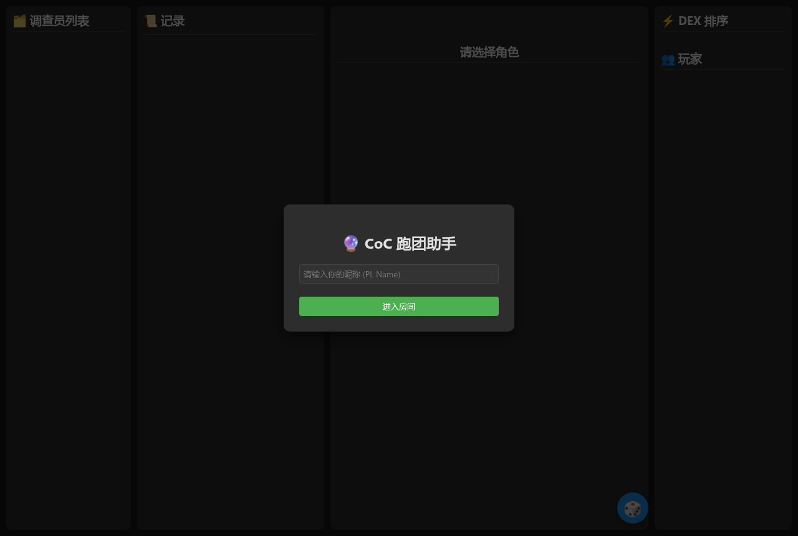
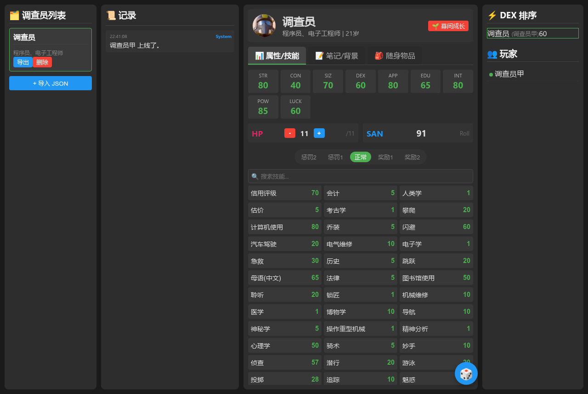

# CoC 跑团助手 · CoC TRPG Real-time Tool

给克苏鲁的呼唤（CoC 7e）跑团用的实时协作工具：调查员列表、角色卡、技能检定、SC 判定、通用投骰、实时日志，多人通过 Socket.IO 同步。



## 功能

- **调查员列表**：多人共享角色，GM 可以清屏/管理日志
- **角色卡**：属性、技能（支持搜索）、物品、背景（stats / bio / items 分页）
- **检定**：点击技能直接投骰判定，支持奖励骰 / 惩罚骰
- **SC 判定**：理智损失（成功 / 失败表达式，如 `1` / `1d4`）
- **通用投骰**：支持 `1d10`、`2d6+1` 等表达式
- **幕间成长**：跑团结束后的技能成长结算
- **实时同步**：Socket.IO 广播玩家、角色卡、日志
- **导入 / 导出**：角色卡 JSON 导入导出，方便备份和迁移
- **持久化**：服务端 `db.json` 保存数据（已在 `.gitignore` 中忽略）



## 快速开始

```bash
npm install
cp db.example.json db.json     # 首次运行；也可以让服务端自动创建
npm start                      # 默认 http://localhost:3000
```

浏览器打开 `http://localhost:3000`，输入昵称进入房间即可。

> 前端通过 CDN 引入 Vue 3 与 Socket.IO 客户端；离线环境可自行下载到 `public/` 并改为本地引用。

## 技术栈

- 后端：Node.js、Express、Socket.IO
- 前端：Vue 3（CDN）、原生 HTML/CSS
- 数据：JSON 文件持久化

## 项目结构

```
.
├── server.js          # Express + Socket.IO 服务端（房间、角色卡、日志、投骰）
├── public/
│   └── index.html     # Vue 3 单页前端
├── db.example.json    # 空数据库示例
├── package.json
└── README.md
```

## 说明

- 默认端口 `3000`，可在 `server.js` 中修改。
- `db.json` 是运行时数据文件，已在 `.gitignore` 中忽略；不要提交真实跑团数据。
- 这是一个个人项目，用于跑团时替代手工记卡和语音报骰。

## License

MIT © 2026 FallWind71
